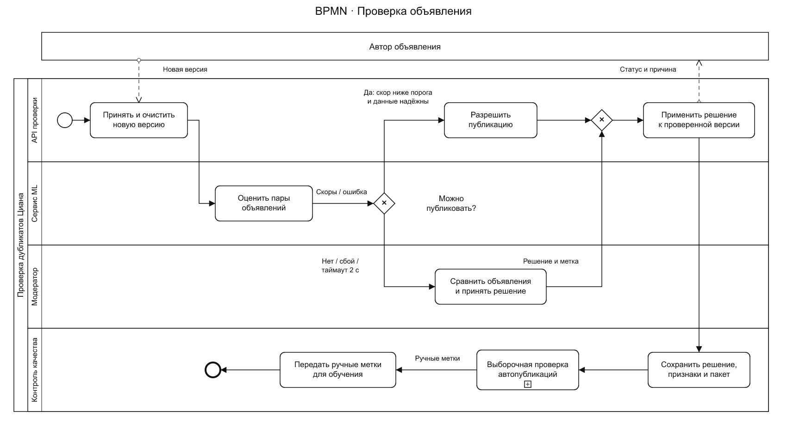
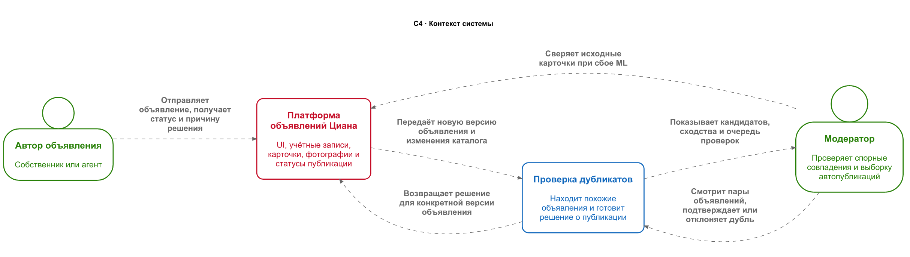
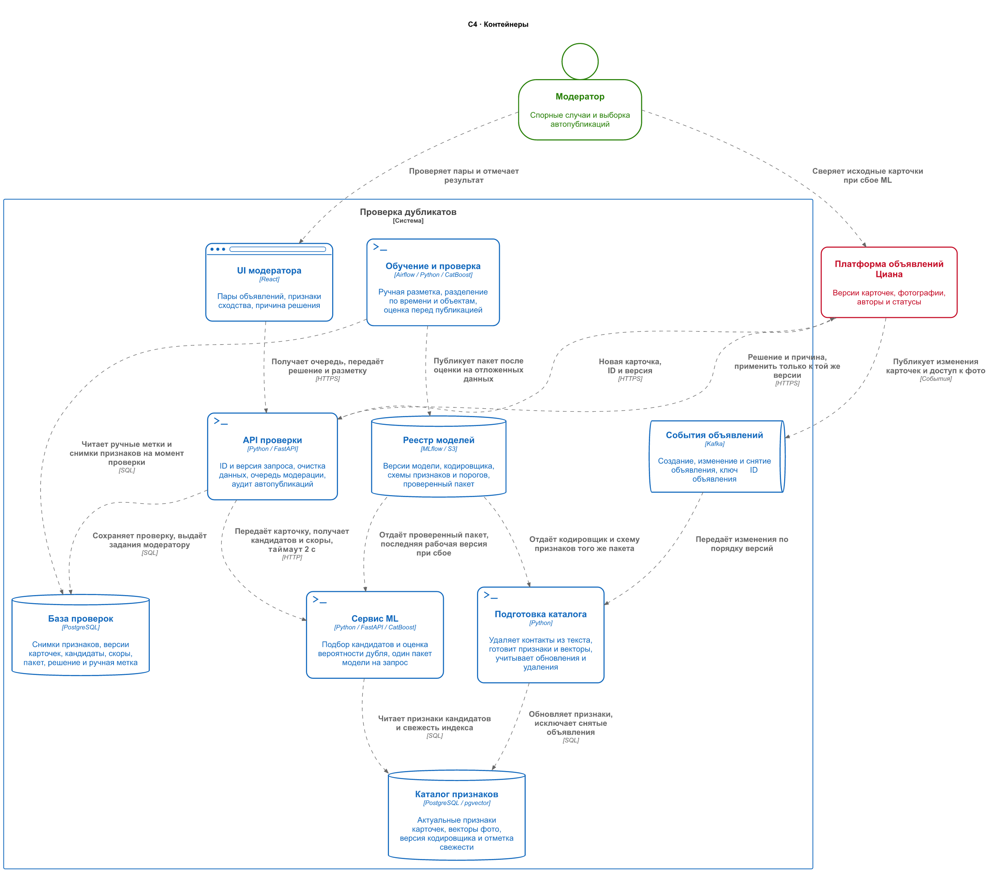
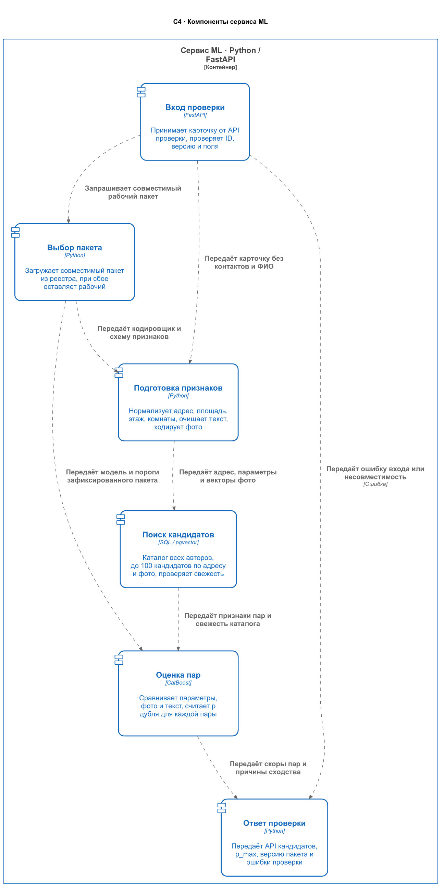

# Домашка 6. Архитектура ML системы

Калабай Михаил Иванович

TLDR

Условно предположим, что оказались в ЦИАНе. Рассматриваю задачу проверки нового объявления перед публикацией. Модель ищет похожие объявления и считает скор дубля. Если всё нормально, карточка публикуется. Если есть подозрение на дубль или проверка сломалась, то решает модератор. Ну и часть ручных решения потом идут в обучение, потому что надо на чём-то учиться понятное дело (ну то есть разметка). Это полностью моя версия того, как такой процесс мог бы работать, не нашёл в инете даже примерную внутреннюю архитектуру Циана

## Что именно проверяем

В этой работе дублем считаю повторное активное объявление об одном объекте с тем же типом сделки и предложением. Кто опубликовал, неважно. Например, собственник и агент выставили одну квартиру на продажу, по этому правилу это тоже дубль. Продажа и аренда считаются разными предложениями. Комната и квартира целиком тоже. Одних похожих фото или адреса недостаточно, модератор должен подтвердить, что это тот же объект и предложение, чтобы не злить собственников в случае сбоя мл и в целом просто ошибок. Бизнес цель понятная. Меньше повторов в объявлениях и меньше ручной работы. Остальные причины модерации тут не рассматриваю

## Как это работает (кратко)

1. Платформа передаёт карточку, ID и версию в API проверки. Убираем контакты и ФИО из текста, фото тоже предполагаются очищенными
2. Сервис ML ищет похожие активные объявления среди всех авторов. Сравнивает характеристики объекта, текст и фото. Для каждой пары считает скор `p`, максимальный называется `p_max`
3. Если данные полные, каталог исправен и `p_max` ниже порога, разрешаем публикацию
4. Подозрение на дубль, неполные данные, сбой или таймаут отправляют карточку модератору
5. API возвращает решение платформе, автор получает статус и причину

Каталог обновляется через Kafka. Снятые объявления исключаем из поиска

## Мои Допущения

Правило дубля, состав сервисов, технологии и так далее взял просто из головы, очевидно в реальной жизни там куча сервисов и куча различных витрин, всякие гринпламы и так далее. Порог и долю ручной выборки надо подбирать на разметке с учётом ошибок и нагрузки на модераторов, поэтому опустил эти моменты на диаграммах. Таймаут 2 секунды, до 100 кандидатов и задержка каталога до 60 секунд тоже условные

Данные для обучения и проверки разделяем по времени и объектам. Перед обновлением смотрим полноту поиска кандидатов, precision, recall и время ответа, ну короче базовые проверки, чтобы понять, что модель не сломает прод. Модель обновляем вместе с совместимыми признаками и кодировщиком, до готовности используем старый пакет как в прошлых дз

## BPMN

Весь процесс. API принимает карточку и применяет решение, сервис ML оценивает пары, модератор проверяет вручную

## C4 Context

Участники и внешняя платформа

## C4 Containers

Сервисы, хранилища и связи между ними

## C4 Components

Внутренности сервиса ML, как всегда взял catboost, без него никуда

